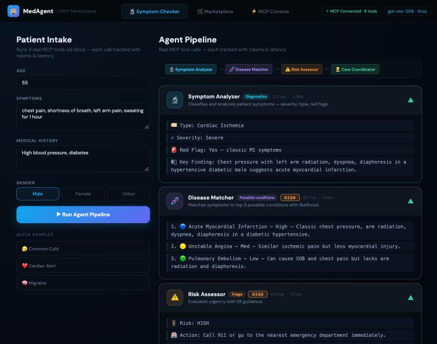

# MedAgent

**A 4-agent symptom-triage pipeline exposed as MCP tools, powered by Groq (openai/gpt-oss-120b).**

[Live demo](https://medagent-rust.vercel.app)

> The backend runs on Render's free tier, which sleeps when idle. The first request after a pause can take about a minute.



> **Medical disclaimer:** MedAgent is an educational and research demo. It is **not** a medical device and does not provide diagnosis or medical advice. Do not enter real personal health information. In an emergency, call your local emergency number.

## What it does

You describe symptoms (plus age, gender and optional medical history). MedAgent runs them through four specialised agents in sequence, and every call reports its token usage and latency.

```
Symptom Analyzer → Disease Matcher → Risk Assessor → Care Coordinator
```

| Agent | Role |
| --- | --- |
| **Symptom Analyzer** | Classifies symptoms by type and severity and flags red-flag signs |
| **Disease Matcher** | Suggests the top 3 possible conditions with relative likelihood |
| **Risk Assessor** | Estimates urgency and gives emergency-care guidance |
| **Care Coordinator** | Suggests specialist referrals, home care and follow-up |

Each agent is also available on its own as an MCP tool, so any compatible client can call it directly.

## Why MCP?

The agents are published as tools through the [Model Context Protocol](https://modelcontextprotocol.io), so they can be discovered and called by MCP clients instead of only through this UI. The server also lists additional demo tools (Legal, Finance, HR, DevOps) to show how new agent suites plug into the same marketplace.

## Architecture

```
┌─────────────────┐   HTTP    ┌──────────────────────┐   API    ┌──────────────┐
│  React + Vite   │ ────────► │  Node.js MCP server  │ ───────► │  Groq        │
│  (Vercel)       │           │  (Render, Docker)    │          │  gpt-oss     │
└─────────────────┘           └──────────────────────┘          └──────────────┘
   Symptom Checker                tool registry
   Marketplace                    pipeline orchestrator
   MCP Console                    execution logs
```

## Tech stack

| Layer | Technology |
| --- | --- |
| Frontend | React, Vite |
| Backend | Node.js, Express (Docker on Render) |
| LLM | Groq, openai/gpt-oss-120b (set with `GROQ_MODEL`) |
| Protocol | Model Context Protocol (MCP) |
| Hosting | Frontend on Vercel, backend on Render |
| Packaging | Docker (Smithery config included) |
| Testing | Node's built-in test runner, GitHub Actions CI |

## Getting started

**Requirements:** Node.js 18+ and a free [Groq API key](https://console.groq.com).

```bash
git clone https://github.com/Amish23102006/medagent
cd medagent
npm install
cp .env.example .env   # then add GROQ_API_KEY (optionally GROQ_MODEL)
npm run dev            # starts the MCP server (port 3001) and Vite (port 5173)
```

Run only the server with `npm start`. Never commit your `.env` file.

### Docker

```bash
docker build -t medagent .
docker run -p 3001:3001 -e GROQ_API_KEY=your_key medagent
```

## Deployment

**Backend (Render)**
- Create a Render **Web Service** from this repo, with branch `main` and runtime **Docker**.
- Set the environment variable `GROQ_API_KEY`. `GROQ_MODEL` is optional (default `openai/gpt-oss-120b`). Render provides `PORT` automatically.
- Set Auto-Deploy to **On Commit** so each push to `main` redeploys the server.
- Health check path: `/health`. It also reports the active model.

**Frontend (Vercel)**
- Import the repo in Vercel (Vite preset).
- Set `VITE_MCP_URL` to the Render service URL, with no trailing slash (for example `https://your-service.onrender.com`). The app appends `/mcp` itself.
- Redeploy after changing the variable, because Vite reads it at build time.

## API endpoints

| Method | Path | Description |
| --- | --- | --- |
| POST | `/mcp` | JSON-RPC 2.0 MCP endpoint (`initialize`, `tools/list`, `tools/call`, `ping`) |
| GET | `/mcp/info` | Server info and capabilities |
| GET | `/mcp/tools` | List available tools |
| GET | `/mcp/suites` | List agent suites |
| POST | `/mcp/tools/{toolId}/execute` | Run a single tool |
| POST | `/mcp/pipeline/execute` | Run the full 4-agent pipeline |
| GET | `/mcp/logs` | Recent execution logs |
| GET | `/health` | Health check |

Inputs are validated against each tool's JSON Schema before any model call. Invalid REST requests return `400` with a list of problems, and invalid JSON-RPC `tools/call` arguments return error `-32602`. Routes that call the model are rate-limited per IP (`RATE_LIMIT_PER_MIN`, default 20), and model calls time out after `GROQ_TIMEOUT_MS` (default 30 seconds).

## Safety and limitations

- Outputs come from a general-purpose LLM and can be wrong, incomplete or overconfident.
- The pipeline is not validated against clinical data or reviewed by clinicians.
- **Red-flag escalation is enforced in code.** The Risk Assessor is instructed to rate red-flag cases HIGH or CRITICAL. If the Symptom Analyzer reports `Red Flag: Yes` and the model still answers MEDIUM or LOW, the server escalates the result to HIGH and adds emergency-care advice. MedAgent must still never be relied on in a real emergency.
- The server does not store submitted text, but the text is sent to the Groq API for inference. Do not submit real patient information.
- Installed suites and execution logs are held in memory, shared by all users and reset when the server restarts.
- The MCP endpoint implements the core JSON-RPC methods with protocol-version negotiation, but not the full Streamable HTTP transport (sessions and SSE streaming).

## Evaluation

Not run yet. Planned: compare the 4-agent pipeline against a single-prompt baseline on a public symptom or medical QA dataset, reporting accuracy, latency and cost per query, with an ablation of each agent.

## Roadmap

- [x] Automated tests and CI
- [x] Input validation against each tool's JSON Schema
- [x] Code-level red-flag escalation, rate limiting and model-call timeouts
- [ ] Streamable HTTP transport that follows the official MCP specification, built on the MCP SDK
- [ ] Benchmark and ablation results
- [ ] Authentication and per-user run history
- [ ] More specialised agents

## License

MIT
